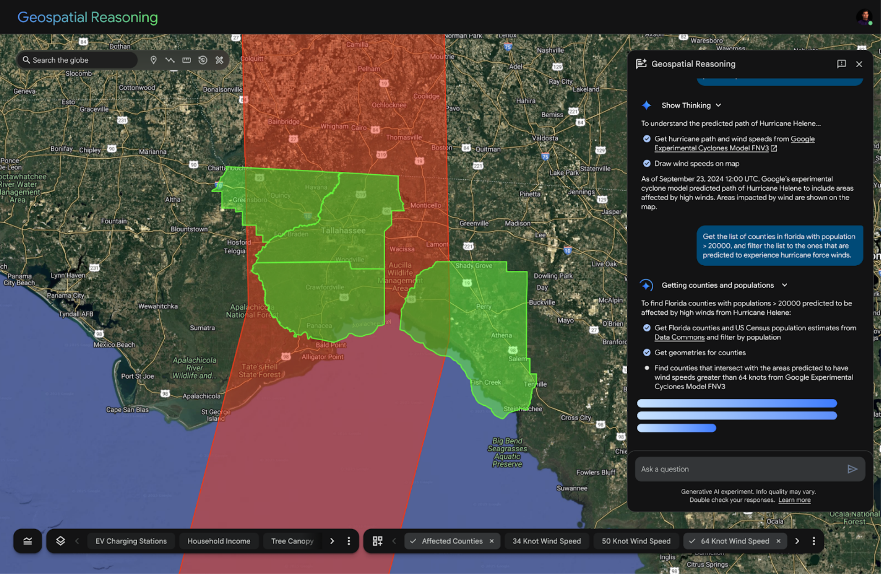
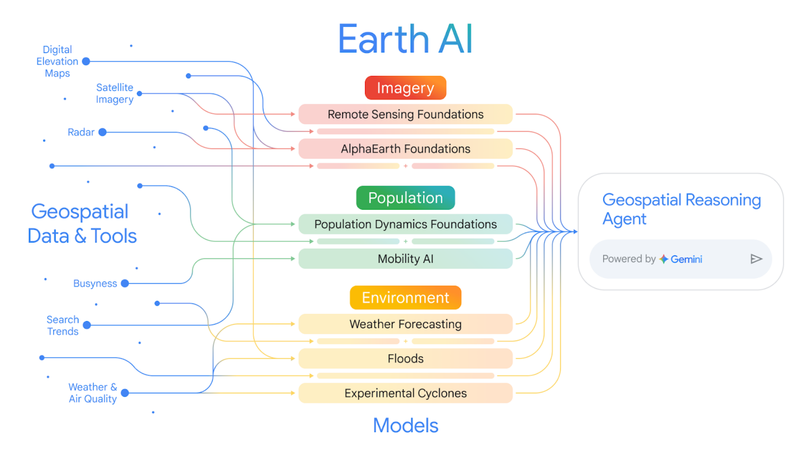
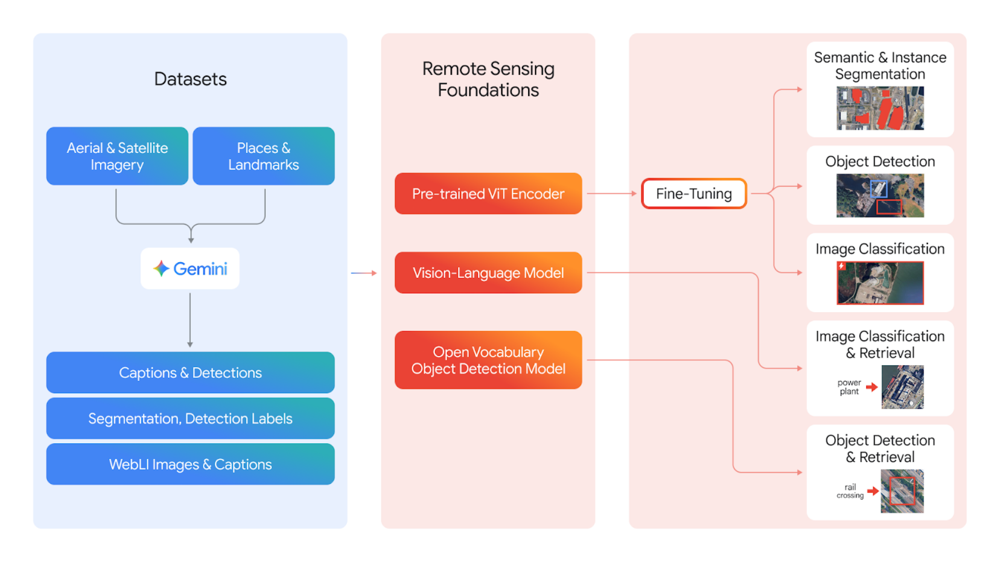
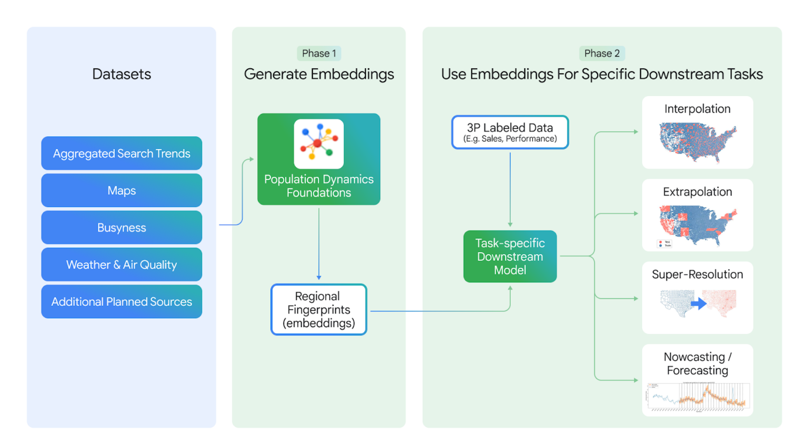
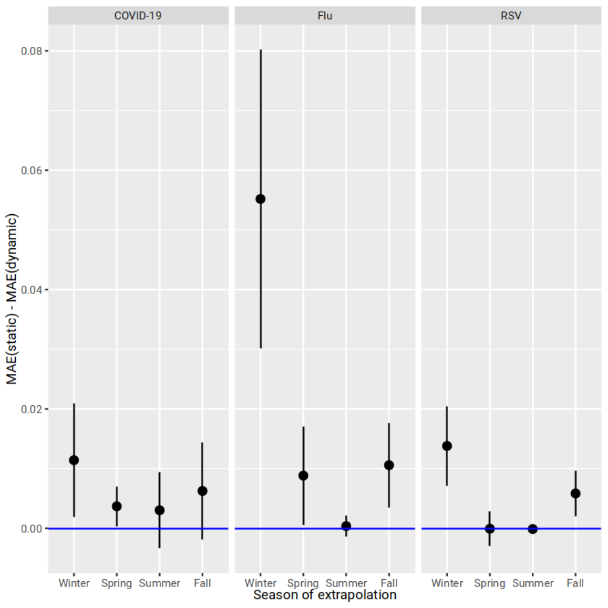
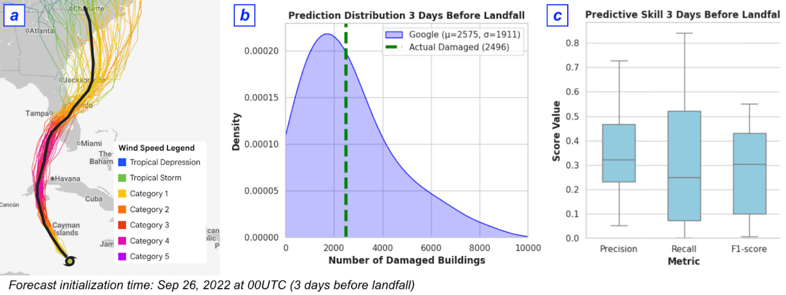
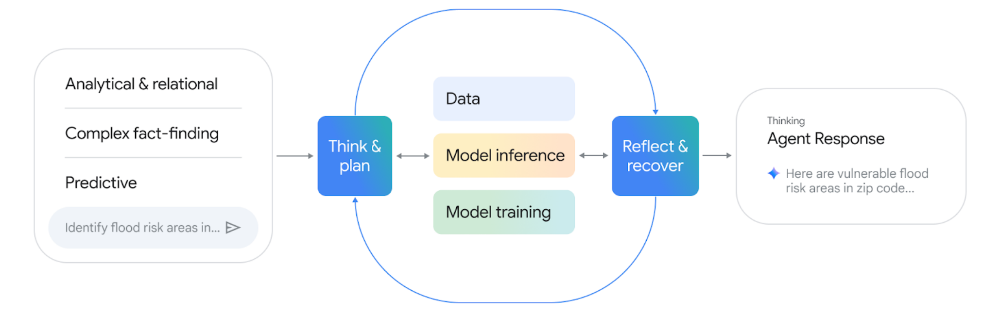

## Earth AI {.cover .dark-slide background-color="#000000"}

```{=html}

<div class="cover-shade" aria-hidden="true"></div>
```

::: {.university-signature}
```{=html}

```

::: {.signature-copy}
University of Missouri

[Statistics and Data Science]{.signature-department}
:::
:::

::: {.cover-body}
[ paper discussion]{.eyebrow}

::: {.hero-title}
Earth [AI]{.gold-text}
:::

::: {.hero-subtitle}
Unlocking geospatial insights with<br>foundation models and cross-modal reasoning
:::

::: {.presenter}


[]{.presenter-affiliation}
:::
:::

::: {.cover-bottom}
Bell et al., arXiv:2510.18318v4, February 2026
:::

```{ojs}
//| output: false
figures = import(await FileAttachment("scripts/figures.js").url())
paper = FileAttachment("data/paper-results.json").json()
```

::: {.notes}
Pacing: 0:30. Cumulative: 0:30.
Introduce this as a discussion of the February 2026 v4 paper by Aaron Bell and
coauthors from Google Research and collaborating Google teams. Our three questions
are what the models represent, whether combining them helps prediction, and how
the authors evaluate the agent that uses them. The presentation contains 24 slides,
with 28 minutes of planned material and two minutes of buffer/discussion.
Paper: https://arxiv.org/pdf/2510.18318v4, p. 1.
Cover photography: Nicholas Andrusisian / University of Missouri, from the
Statistics and Data Science department homepage, https://stat.missouri.edu/.
Original university shield from the same website. This custom academic theme
does not imply university endorsement of the paper.
:::

## A question that requires several models {#motivating-question .dark-slide background-color="#000000"}

```{=html}
<div class="question-layout">
  <div class="question-copy">
    <p class="eyebrow">Hurricane Helene</p>
    <p class="large-question">Which Florida counties face predicted hurricane-force winds?</p>
    <p class="question-filter">Restrict the answer to counties with more than <strong>20,000 residents</strong>.</p>
    <p class="small-copy">Forecast reference time<br>September 23, 2024, 12:00 UTC</p>
  </div>
  <figure class="question-map">
    
    <figcaption>Published demonstration, Figure 7</figcaption>
  </figure>
</div>
```

::: {.source-line}
Bell et al., pp. 22–23, Figure 7. Question paraphrased from the authors’ demonstration.
:::

::: {.notes}
Pacing: 1:12. Cumulative: 1:42.
Pose the paper's actual Helene example, paraphrased for readability. The question
specifies a historical forecast initialization time, a geographic scope, a wind
criterion, and a population threshold. Its answer requires a prediction model,
demographic records, county geometries, and spatial intersection. The image is the
authors' published demonstration, not a new live forecast. We will return to its
four-county answer after introducing the components. Do not describe the green
polygons as observed damage, or as a newly computed result of this presentation.
Source: https://arxiv.org/pdf/2510.18318v4, pp. 22–23, Figure 7.
:::

## Why geospatial analysis is difficult {#data-mismatch}

::: {.slide-intro}
The information is abundant. Its units of observation differ.
:::

```{=html}
<div class="editorial-columns">
  <div><span class="column-index">01</span><h3>Space</h3>
    <p>Image pixels, postal areas, and administrative regions.</p>
    <p class="small-copy">Features must describe the same geographic unit before they can be combined.</p></div>
  <div><span class="column-index">02</span><h3>Time</h3>
    <p>Annual embeddings, monthly behavior, and evolving forecasts.</p>
    <p class="small-copy">Signals summarize different periods and update at different rates.</p></div>
  <div><span class="column-index">03</span><h3>Coverage</h3>
    <p>Different sensors, sources, and patterns of missing data.</p>
    <p class="small-copy">A useful analysis must discover and join the relevant sources.</p></div>
</div>
<p class="bottom-takeaway">Earth AI organizes these sources into specialized models and a reasoning agent.</p>
```

::: {.source-line}
Bell et al., pp. 1–2, 5–7; spatial and temporal alignment discussed on p. 24.
:::

::: {.notes}
Pacing: 1:00. Cumulative: 2:42.
Frame the problem in statistical terms: observations have different spatial
supports, temporal resolutions, and coverage. The examples here summarize the
sources described in the paper. The authors later identify alignment across
spatial and temporal granularities as a continuing technical challenge. We are
not assuming that all signal differences disappear after embedding. This sets
up the distinction between learning representations and integrating them.
Source: https://arxiv.org/pdf/2510.18318v4, pp. 1–2, 5–7, 24.
:::

## The Earth AI framework {#framework}

```{=html}
<div class="image-layout">
  <figure class="paper-image"></figure>
  <div class="note-column">
    <p class="eyebrow">Figure 1</p>
    <div class="fragment"><h3>Specialized models</h3><p>Represent different aspects of a place.</p></div>
    <div class="fragment"><h3>Predictive applications</h3><p>Combine representations for a target task.</p></div>
    <div class="fragment"><h3>Reasoning agent</h3><p>Selects tools and connects their outputs.</p></div>
  </div>
</div>
```

::: {.source-line}
Bell et al., p. 3, Figure 1. Original published figure.
:::

::: {.notes}
Pacing: 1:18. Cumulative: 4:00.
Read Figure 1 from left to right. The paper describes a family of interoperable
models and tools. Imagery includes Remote Sensing Foundations and AlphaEarth.
Population includes Population Dynamics and a wider family of mobility tools.
Environment includes weather, floods, and experimental cyclones. The reasoning
agent connects to these specialized capabilities. Use the fragments to distinguish
the foundation models, the downstream predictive applications, and orchestration.
These three levels are evaluated separately later in the paper.
Source: https://arxiv.org/pdf/2510.18318v4, p. 3, Figure 1.
:::

## Remote Sensing Foundations {#remote-sensing}

```{=html}
<div class="image-layout">
  <figure class="paper-image"></figure>
  <div class="note-column">
    <p class="eyebrow">Figure 2</p>
    <h3>Three capabilities</h3>
    <p>Image–text matching</p><p>Open-vocabulary detection</p><p>Fine-tunable vision backbone</p>
    <p class="side-callout">AlphaEarth is complementary: annual embeddings at 10 m resolution.</p>
  </div>
</div>
```

::: {.source-line}
Bell et al., pp. 4–5, Figure 2. Remote Sensing Foundations operates on RGB imagery at 0.1–10 m resolution.
:::

::: {.notes}
Pacing: 1:12. Cumulative: 5:12.
The authors combine remote-sensing imagery and places information, including
Gemini-generated captions, with web image–text pairs and labeled detection and
segmentation data. Figure 2 shows how these sources support the three model
capabilities. Zero-shot text matching uses a common embedding space for images
and descriptions. The open-vocabulary detector supports text-specified categories.
The backbone is fine-tuned for particular visual tasks. Distinguish these models
from AlphaEarth, whose annual 10 m embeddings summarize multiple environmental
sources. The paper does not train one single model for all of these functions.
Source: https://arxiv.org/pdf/2510.18318v4, pp. 4–5, Figure 2.
:::

## Evidence from object detection {#detection}

::: {.slide-intro}
Specialization improves zero-shot detection on both benchmarks.
:::

::: {.results-layout}
::: {.results-narrative}

```{ojs}
viewof detectionDataset = figures.selector("Detection dataset", ["DOTA", "DIOR"], "DOTA")
```

### Zero-shot detection

No additional labeled examples for adaptation to the benchmark.

::: {.side-callout}
**mAP (%)** summarizes detection performance. Higher is better.
:::

:::
::: {.results-figure}

```{ojs}
figures.detectionChart(paper.detection, detectionDataset)
```

:::
:::

::: {.source-line}
Bell et al., p. 10, Table 3. Published mAP (%) values; zero-shot results only.
:::

::: {.notes}
Pacing: 1:06. Cumulative: 6:18.
Start with DOTA: the generic OWL-ViT-v2 baseline scores 13.77 mAP and the
remote-sensing version scores 31.83. Switch to DIOR to show that the pattern holds
there: 14.98 for the baseline and 29.39 for the remote-sensing version. DOTA and
DIOR are public remote-sensing object-detection benchmarks. Zero-shot means no
additional labeled examples for adapting the detector to the benchmark; the
models have already been pretrained. mAP summarizes precision-recall performance
across object categories, not the percentage of all objects correctly detected.
These are object detection results, not evidence that every imagery task improves
by the same amount. This slide presents only the zero-shot rows of Table 3.
Additional classification, retrieval, and fine-tuned backbone results are in
Tables 1–2 and 4–5. No uncertainty estimates are supplied in Table 3.
Source: https://arxiv.org/pdf/2510.18318v4, p. 10, Table 3.
:::

## Population Dynamics Foundations {#population}

```{=html}
<div class="image-layout">
  <figure class="paper-image"></figure>
  <div class="note-column">
    <p class="eyebrow">Figure 3</p>
    <h3>Regional embeddings</h3>
    <p>A graph neural network combines heterogeneous regional signals.</p>
    <p class="side-callout">Embeddings become inputs to downstream models for interpolation, transfer, super-resolution, and forecasting.</p>
  </div>
</div>
```

::: {.source-line}
Bell et al., pp. 5–6, Figure 3. Inputs include aggregated Search Trends, maps, anonymized busyness, weather, and air quality.
:::

::: {.notes}
Pacing: 1:18. Cumulative: 7:36.
An embedding is a numerical representation of a region. Here the authors use
a graph neural network to combine data about the built environment, environmental
conditions, and human behavior. Phase 1 creates the regional representation.
Phase 2 fits a downstream model using available labels and the embeddings.
Distinguish interpolation into missing regions, transfer to new regions,
super-resolution to finer areas, and forecasting forward in time. The paper
extends earlier work to 17 countries and monthly representations over two years.
Do not interpret a region's embedding as an individual-level behavioral record.
Source: https://arxiv.org/pdf/2510.18318v4, pp. 5–6, Figure 3.
:::

## Prediction across countries {#country-transfer}

::: {.slide-intro}
Train on seven European countries. Evaluate on regions in France.
:::

::: {.compact-control}

```{ojs}
viewof transferMetric = figures.selector("Transfer metric", [{value: "r2", label: "R² — higher is better"}, {value: "mape", label: "MAPE (%) — lower is better"}], "r2")
```

:::

```{ojs}
figures.transferChart(paper.transfer, transferMetric)
```

::: {.source-line}
Bell et al., pp. 12–13, Table 7. NUTS3 regions. Training: BE, CH, DE, ES, UK, IT, NL. Test: France.
:::

::: {.notes}
Pacing: 1:12. Cumulative: 8:48.
This is a concrete transfer experiment rather than a claim of universal global
generalization. The training countries are Belgium, Switzerland, Germany, Spain,
the United Kingdom, Italy, and the Netherlands. The model predicts GDP per capita,
death rate, and fertility rate in French NUTS3 regions. The comparison methods
are inverse distance weighting and radial basis functions. Population embeddings
achieve R² of 0.52, 0.78, and 0.71. Switch to MAPE only if useful for the audience,
remembering that lower is better. The full 17-country interpolation analysis is
Table 6, a different evaluation design.
Source: https://arxiv.org/pdf/2510.18318v4, pp. 12–13, Tables 6–7.
:::

## Why embeddings change over time {#temporal-embeddings}

```{=html}
<div class="temporal-layout">
  <figure class="paper-image square-figure"></figure>
  <div class="note-column">
    <p class="eyebrow">Figure 5</p>
    <h3>Static versus time-matched</h3>
    <p>Monthly emergency-department visits<br>COVID-19, flu, and RSV</p>
    <div class="number-pair"><div><strong>24</strong><span>months</span></div><div><strong>10</strong><span>held-out states</span></div></div>
    <p class="side-callout">Positive differences favor dynamic embeddings. Some intervals include zero.</p>
    <p class="small-copy">Error bars: ±2 SE, assuming independence across months and locations.</p>
  </div>
</div>
```

::: {.source-line}
Bell et al., pp. 13–14, Figure 5. This is monthly spatial extrapolation, not a future disease-forecast evaluation.
:::

::: {.notes}
Pacing: 1:24. Cumulative: 10:12.
The plot shows MAE(static) minus MAE(dynamic). A positive point favors using the
current month's embedding instead of the static July 2023 embedding. The task
predicts the share of emergency visits for held-out counties in ten states,
month by month across 24 months beginning July 2023. It uses current-month
embeddings, so describe it as spatial extrapolation at matching times. The
winter flu improvement is prominent. Several other intervals intersect zero,
so avoid claiming significance for every season–disease pair. The ±2 SE bars
assume months and locations are independent, an assumption relevant to this
statistics audience. We retain the published plot because raw values are absent.
Source: https://arxiv.org/pdf/2510.18318v4, pp. 13–14, Figure 5.
:::

## Environmental forecasts {.gold-slide background-color="#FDB719" #environment}

::: {.slide-intro}
The agent connects to distinct forecast models and APIs.
:::

```{=html}
<div class="environment-rows">
  <div><h3>Weather</h3><p>Temperature, precipitation, wind, UV</p><strong>Up to 10 days</strong></div>
  <div><h3>River floods</h3><p>Inundation, severity, probability</p><strong>Forecast API</strong></div>
  <div><h3>Experimental cyclones</h3><p>Formation, track, intensity, size, shape</p><strong>50 scenarios / 15 days</strong></div>
</div>
```

::: {.source-line}
Bell et al., pp. 6–7. Weather: hourly to 240 h and daily to 10 days. No common horizon is assigned here to the flood API.
:::

::: {.notes}
Pacing: 0:48. Cumulative: 11:00.
Weather forecasting is accessed through the Google Maps Platform Weather API,
which incorporates models such as MetNet. Flood forecasting provides riverine
predictions, including severity and inundation information. The experimental
cyclone model generates 50 possible scenarios up to 15 days in advance.
These are the environmental signals integrated in the evaluation; the paper
also places them within a wider weather and climate ecosystem. Do not present
this slide as a newly trained, unified environmental foundation model, or as
current product availability beyond what this paper reports.
Source: https://arxiv.org/pdf/2510.18318v4, pp. 6–7, Section 2.1.3.
:::

## Combining representations at a common geography {#fusion-pipeline}

::: {.slide-intro}
Both feature sets must describe the same census tract.
:::

```{=html}
<div class="fusion-pipeline">
  <div class="pipeline-lane"><div><span class="eyebrow">AlphaEarth</span><h3>64 bands at 10 m</h3><p>2023 annual embeddings</p></div>
    <div class="pipeline-transform"><h3>10-bin histograms</h3><p>Summarize each band within a tract</p></div>
    <div><strong class="feature-count">640</strong><p>features per tract</p></div></div>
  <div class="pipeline-lane fragment"><div><span class="eyebrow">Population Dynamics</span><h3>Postal-code embeddings</h3><p>Regional human-context features</p></div>
    <div class="pipeline-transform"><h3>Area-weighted averaging</h3><p>2020 land-area overlap weights</p></div>
    <div><strong class="feature-label">Tract</strong><p>population features</p></div></div>
</div>
<div class="model-strip fragment"><strong>Combined features</strong><span>Gradient-boosted trees</span><span>A separate predictor for each target</span></div>
<p class="small-copy split-note">Tracts in 80% of counties: training/validation. Tracts in 20%: testing.</p>
```

::: {.source-line}
Bell et al., pp. 16–18; Appendix A.2.1, p. 37. Evaluated tree models use a fixed set of hyperparameters.
:::

::: {.notes}
Pacing: 1:30. Cumulative: 12:30.
This diagram adapts the explicit Appendix A.2.1 procedure. AlphaEarth has 64
bands at 10 m. Ten histogram features per band produce 640 tract features.
The native population embeddings are at US postal-code level and become tract
features through area-weighted averaging. The target-specific models are
gradient-boosted decision trees. The Appendix states that the reported experiments
use fixed hyperparameters, without label-specific tuning. The discussion more
generally notes target-specific tuning as a limitation, so describe this concrete
evaluated procedure rather than inferring a search protocol. Counties, rather
than individual tracts, define the train/test partition. This evaluates transfer
across held-out counties, not future-time forecasting or causal identification.
Source: https://arxiv.org/pdf/2510.18318v4, pp. 16–18, 37.
:::

## FEMA risk prediction {#fema-results}

::: {.slide-intro}
Complementary features help on most of the 20 reported targets.
:::

::: {.results-layout}
::: {.results-narrative}

```{ojs}
viewof femaTarget = figures.selector("FEMA target", figures.targetOptions(paper.fusion.fema), "mean")
figures.fusionSummary(paper.fusion.fema, femaTarget)
```

::: {.side-callout}
**Wildfire is an exception.**<br>AlphaEarth: 0.77<br>Combined: 0.76
:::

:::
::: {.results-figure}

```{ojs}
figures.fusionChart(paper.fusion.models, paper.fusion.fema, femaTarget)
```

:::
:::

::: {.source-line}
Bell et al., p. 17, Table 9. Published rounded test-set R² values. No confidence intervals are supplied for this table.
:::

::: {.notes}
Pacing: 1:30. Cumulative: 14:00.
The three means shown are 0.54, 0.54, and 0.60. The authors report an average
relative R² improvement of 11%. Do not equate this with an 11-percentage-point
increase or a general reduction in forecast error. Use the selector to show
social vulnerability (0.30, 0.44, 0.48) or coastal flooding (0.33, 0.24, 0.38).
Then select wildfire (0.77, 0.54, 0.76) to demonstrate that combination is not
uniformly superior. Drought and hail include ties with the better single source.
All 20 targets are selectable and preserve Table 9's values. The labels are FEMA
risk indices, not realized future disaster losses. Reset to the mean if desired.
Source: https://arxiv.org/pdf/2510.18318v4, pp. 16–17, Table 9.
:::

## Health indicator prediction {#health-results}

::: {.slide-intro}
The same modeling setup predicts 21 CDC health indicators.
:::

::: {.results-layout}
::: {.results-narrative}

```{ojs}
viewof healthTarget = figures.selector("Health indicator", figures.targetOptions(paper.fusion.health), "mean")
figures.fusionSummary(paper.fusion.health, healthTarget)
```

::: {.side-callout}
The combined features have higher reported R² for **all 21 indicators**.
:::

:::
::: {.results-figure}

```{ojs}
figures.fusionChart(paper.fusion.models, paper.fusion.health, healthTarget)
```

:::
:::

::: {.source-line}
Bell et al., pp. 17–18, Table 10. Same county-based holdout design. Predictive associations do not identify causal effects.
:::

::: {.notes}
Pacing: 1:00. Cumulative: 15:00.
Use the same chart design so the audience can compare the domains. The average
R² is 0.42 for AlphaEarth, 0.56 for Population Dynamics, and 0.60 combined.
For example, diabetes gives 0.39, 0.59, and 0.61. Every combined value in Table 10
exceeds both single-source values. This supports complementary predictive
information in this setup, without establishing which source causes a health
outcome. The target statistics are CDC indicators retrieved through Data Commons.
No new health data or individual-level inference is introduced here.
Source: https://arxiv.org/pdf/2510.18318v4, pp. 17–18, Table 10.
:::

## Hurricane damage prediction {#damage-pipeline .dark-slide background-color="#000000"}

::: {.slide-intro}
Forecast uncertainty passes through a building-damage classifier.
:::

```{=html}
<div class="damage-pipeline">
  <div class="damage-stage"><span class="stage-index">01</span><h3>Cyclone ensemble</h3><p>50 possible tracks and wind fields</p></div>
  <div class="damage-stage fragment"><span class="stage-index">02</span><h3>Building context</h3><p>Property characteristics, local environment, population embeddings</p></div>
  <div class="damage-stage fragment"><span class="stage-index">03</span><h3>Damage model</h3><p>Gradient-boosted classifier for each forecast member</p></div>
</div>
<div class="dark-summary fragment"><strong>50</strong><p>sets of building predictions<br>and a distribution of damaged-building counts</p></div>
```

::: {.source-line}
Bell et al., pp. 18–19; Appendix A.2.2, pp. 37–38. Training dataset spans 22 hurricane events, 2017–2022.
:::

::: {.notes}
Pacing: 1:12. Cumulative: 16:12.
Bellwether's damage model combines property-level information with hurricane
conditions and local features. The data span 22 events and six years, with six
recent events held out for validation and testing. The classifier is trained
using observed hurricane information. To forecast, the authors replace observed
tracks and wind speeds with the experimental cyclone ensemble and run all 50
members through the classifier. Static building and population information stays
the same. The forecast distribution reflects variation across those ensemble
members; it is not a normal distribution supplied by this presentation.
Source: https://arxiv.org/pdf/2510.18318v4, pp. 18–19, 37–38.
:::

## Hurricane Ian: counts and building-level skill {#ian-results}

::: {.slide-intro}
Study subset: **2,575 predicted** and **2,496 observed** damaged buildings.
:::

```{=html}
<figure class="wide-paper-figure"></figure>
<p class="figure-warning">About 3% aggregate count error. One retrospective event, one lead time, and a subset of affected buildings.</p>
```

::: {.source-line}
Bell et al., p. 19, Figure 6; p. 38. The count comparison does not imply 97% building-level classification accuracy.
:::

::: {.notes}
Pacing: 1:48. Cumulative: 18:00.
Read the actual panels. Panel a shows the 50 forecast tracks and the observed
track in black. Panel b shows predicted counts three days before landfall,
with the observed count marked by the green dashed line. The mean is close,
but the distribution is broad. Panel c shows ensemble variation in precision,
recall, and F1. A close aggregate count can coexist with errors in which
particular buildings are classified as damaged. This illustration is restricted
to one event and initialization time, and to the study subset of properties.
Appendix Table 13 reports damaged-building recall 0.60, precision 0.57, and F1 0.59
under a DIFFERENT evaluation using observed tracks. Those are not panel c's
forecast scores and must not be substituted for them. Damage labels are rare,
below 4% per event in the dataset, making raw accuracy an unhelpful headline.
Source: https://arxiv.org/pdf/2510.18318v4, pp. 19, 37–38.
:::

## Cholera forecasting in the DRC {#cholera}

::: {.slide-intro}
TimesFM combines past case counts with regional context and weather covariates.
:::

```{=html}
<div class="cholera-inputs"><div><h3>Weekly cases</h3><p>Historical observations<br>24 DRC provinces</p></div><div><h3>Population embeddings</h3><p>Static numerical<br>province covariates</p></div><div><h3>Weather forecasts</h3><p>Precipitation<br>and temperature</p></div></div>
<div class="model-strip"><strong>TimesFM 2.0</strong><span>National and regional cholera forecasts</span></div>
<div class="metric-pair"><div><strong>35.4%</strong><p>Lower RMSE than Prophet<br>TimesFM baseline, national, 20 weeks</p></div><div><strong>5%</strong><p>Lower regional RMSE than baseline TimesFM<br>with population embeddings</p></div></div>
```

::: {.source-line}
Bell et al., pp. 19–20. Different comparisons and aggregation levels; the percentages are not additive.
:::

::: {.notes}
Pacing: 1:00. Cumulative: 19:00.
The authors collaborate with WHO AFRO using weekly cholera records from 24
provinces. The TimesFM baseline uses historical case counts. National RMSE at a
20-week horizon improves 35.4% over Prophet. At regional level, adding population
embeddings reduces RMSE by 5% against baseline TimesFM. The text also reports
32.7% performance improvement after adding dynamic weather forecasts, but gives
less experimental detail; do not combine it with the two displayed percentages
or fabricate a forecast curve. The model uses static province embeddings and
dynamic temperature and precipitation covariates. These are separate reported
comparisons, not a single common-scale ablation chart.
Source: https://arxiv.org/pdf/2510.18318v4, pp. 19–20.
:::

## How the geospatial agent operates {#agent-loop}

::: {.slide-intro}
Gemini orchestrates data access, model calls, and analysis through ADK.
:::

```{=html}
<figure class="agent-loop-figure"></figure>
<div class="loop-labels"><p class="fragment"><strong>Plan</strong><br>Choose the next operation</p><p class="fragment"><strong>Execute</strong><br>Retrieve, infer, or train</p><p class="fragment"><strong>Reflect</strong><br>Revise or synthesize</p></div>
```

::: {.source-line}
Bell et al., pp. 7–9, Figure 4; Appendix A.3.1, pp. 38–39. Figure cropped to its diagram, without changing its content.
:::

::: {.notes}
Pacing: 1:12. Cumulative: 20:12.
The agent uses Google's Agent Development Kit and Gemini. The framework's
closed loop chooses operations, calls models or data tools, and reflects on
results. Some domains are expert agents, such as demographics, weather, model
training, Earth Engine, and search. Location/places and imagery can be toolsets.
The framework supports on-the-fly training of lightweight models on pretrained
embeddings. Figure 4 is a schematic of intended operation, not a measured
guarantee that recovery succeeds in all cases. The map-based UI is useful for
the demonstration but is not itself part of the formal benchmark.
Source: https://arxiv.org/pdf/2510.18318v4, pp. 7–9, 38–39.
:::

## Returning to the Helene question {#helene-walkthrough}

```{=html}
<div class="helene-layout">
  <figure class="paper-image"></figure>
  <div class="walkthrough">
    <p class="fragment"><strong>1</strong> Retrieve the wind forecast.</p>
    <p class="fragment"><strong>2</strong> Retrieve county populations and boundaries.</p>
    <p class="fragment"><strong>3</strong> Filter population above 20,000.</p>
    <p class="fragment"><strong>4</strong> Intersect counties with the wind polygon.</p>
    <div class="walkthrough-answer fragment"><strong>4 counties</strong><span>shown in green in the paper</span></div>
  </div>
</div>
```

::: {.source-line}
Bell et al., pp. 22–23, Figure 7. Published demonstration, not a live forecast or a new GIS calculation.
:::

::: {.notes}
Pacing: 1:00. Cumulative: 21:12.
Return to the opening question. The red polygon represents predicted
hurricane-force winds from the cyclone model. County populations come from the
US Census Bureau through Data Commons. The agent retrieves geometries, applies
the population threshold, and computes intersections. The authors identify four
counties, highlighted in green. Reveal each operation before the answer. We
show their original result rather than inventing county-level data or rerunning
an unavailable forecast system. This illustrates cross-domain orchestration;
it does not independently validate the forecast's meteorological accuracy.
Source: https://arxiv.org/pdf/2510.18318v4, pp. 22–23, Figure 7.
:::

## How the Q&A benchmark is scored {#qa-design}

```{=html}
<div class="benchmark-design">
  <div class="benchmark-size"><strong>100</strong><p>questions with verified reference answers</p><div class="split-count"><span><b>50</b> descriptive / retrieval</span><span><b>50</b> analytical / relational</span></div></div>
  <div class="benchmark-rules"><h3>Partial-credit answer matching</h3><p>Text: ROUGE-L F1</p><p>Numbers: score based on relative error<br>Full credit within ±10% of the reference</p><p class="side-callout">Five runs. Baselines also have Search, Maps grounding, and Code Execution.</p></div>
</div>
```

::: {.source-line}
Bell et al., pp. 20–21; Appendix A.3.2–A.3.3, pp. 40–42. Scoring ignores surrounding answer prose.
:::

::: {.notes}
Pacing: 1:06. Cumulative: 22:18.
The 100 questions cover places (30), people and communities (40), weather and
environment (20), and multiple domains (10). Each domain is equally split across
the two question categories. Reference answers come from direct API or dataset
queries, reviewed by geospatial experts. Only the filled blanks are scored.
Text uses ROUGE-L F1. For numbers, relative errors within 10% receive one;
errors above 100% receive zero; otherwise the score is one minus the absolute
percentage error. Thus 0.82 does not mean 82 exact answers out of 100. The
baseline agents use Gemini 2.5 Flash or Pro within ADK with built-in Search,
Maps grounding, and Code Execution, but lack custom geospatial tools.
Source: https://arxiv.org/pdf/2510.18318v4, pp. 20–21, 40–42.
:::

## Agent performance on retrieval and analysis {#qa-results}

::: {.slide-intro}
The specialized agent has higher scores in both categories.
:::

::: {.results-layout}
::: {.results-narrative}

```{ojs}
viewof qaCategory = figures.selector("Q&A category", paper.qa.categories.map(d => ({value: d.id, label: d.label})), "overall")
```

### Analytical tasks

Pro: **0.33**<br>Geospatial agent: **0.74**

::: {.side-callout}
Intervals describe variation across **five runs** of this benchmark.
:::

:::
::: {.results-figure}

```{ojs}
figures.qaChart(paper.qa, qaCategory)
```

:::
:::

::: {.source-line}
Bell et al., p. 21, Table 11. Points and published 95% confidence intervals. Scores are not exact-answer accuracy.
:::

::: {.notes}
Pacing: 1:24. Cumulative: 23:42.
Overall means are 0.39 for Flash, 0.50 for Pro, and 0.82 for the geospatial
agent. Switch to descriptive retrieval: 0.60, 0.67, and 0.91. Analytical
questions are harder for the baselines: 0.17, 0.33, and 0.74. These results support
the value of the specialized system on the chosen tasks. The comparison changes
the tool access and agent configuration as well as the data available, so it
does not isolate an improvement in the underlying LLM's intrinsic reasoning.
Intervals are the authors' reported 95% intervals across five runs; they do not
establish uncertainty for every future region, disaster, or query distribution.
Source: https://arxiv.org/pdf/2510.18318v4, p. 21, Table 11.
:::

## Evaluation on crisis-response prompts {#crisis-results}

::: {.crisis-layout}
::: {.crisis-plot}

```{ojs}
figures.crisisChart(paper.crisis, crisisIntervals)
```

:::
::: {.crisis-narrative}

```{ojs}
viewof crisisIntervals = figures.selector("Crisis intervals", [{value: "yes", label: "Show published 95% intervals"}, {value: "no", label: "Show means only"}], "yes")
```

### 10 prompts<br>10 runs each

Gemini 2.5 Flash rates rubric compliance on a five-level scale.

::: {.side-callout}
Reported mean, excluding #9:<br>Pro **0.38**<br>Agent **0.87**
:::

:::
:::

::: {.source-line}
Bell et al., p. 22, Table 12; pp. 52–53. *Prompt 9 excluded from the reported mean. Intervals retained as published, without clipping to [0, 1].
:::

::: {.notes}
Pacing: 1:18. Cumulative: 25:00.
This is a different benchmark from the 100-question evaluation. Ten constrained
crisis prompts combine predictive models with demographic or geospatial tasks.
Each prompt runs ten times. A Gemini 2.5 Flash autorater checks a custom rubric
and maps five Likert-style levels to 0, .25, .5, .75, and 1. The plotted intervals
are exactly the published means plus/minus interval widths. Some extend beyond
the bounded score range; do not silently truncate or reinterpret them. Prompt 9
has zero for Pro because it could not find authoritative 2024 labor statistics.
Table 12 excludes that prompt from the reported mean: 0.38 versus 0.87.
Rubric compliance is not direct validation of the underlying forecast accuracy.
Source: https://arxiv.org/pdf/2510.18318v4, pp. 21–22, 48, 52–53.
:::

## What the evaluation establishes {#interpretation}

::: {.slide-intro}
Our statistical reading: each result answers a different question.
:::

```{=html}
<table class="evidence-table">
  <thead><tr><th>Reported quantity</th><th>What it measures</th><th>Limit of the interpretation</th></tr></thead>
  <tbody>
    <tr><td>FEMA / health R²</td><td>Prediction of tract-level targets in held-out counties</td><td>Predictive association does not identify causal effects.</td></tr>
    <tr><td>Ian count error</td><td>Aggregate damage count in one study subset</td><td>A close total does not identify the correct buildings.</td></tr>
    <tr><td>Q&A score</td><td>Partial-credit match to reference answers</td><td>Repeated runs do not test every new query distribution.</td></tr>
    <tr><td>Crisis rubric score</td><td>Compliance with specified response criteria</td><td>A plausible method description can be difficult to verify.</td></tr>
  </tbody>
</table>
```

::: {.source-line}
Interpretation of Bell et al., Tables 9–12, Figure 6, Appendix A.2.2 and A.3.3–A.3.4. See pp. 17–22, 38, 42, 48, 52–53.
:::

::: {.notes}
Pacing: 1:12. Cumulative: 26:12.
This slide is our statistical reading, not an additional experiment reported
by the authors. Align the unit of the claim with the unit of evaluation.
Embedding experiments test target prediction in held-out counties. The Ian
count describes aggregate error in a particular subset and initialization.
Q&A scores summarize partial-credit answer matching, while crisis scores
summarize an automated rubric. Appendix p. 48 explicitly warns that rubric
evaluation can struggle to verify whether the system actually analyzed data
or synthesized secondary sources. The paper also acknowledges the need for
stronger generalization tests. Keep these distinctions when interpreting gains.
Source: https://arxiv.org/pdf/2510.18318v4, pp. 17–22, 38, 42, 48, 52–53.
:::

## Limitations acknowledged by the authors {#limitations}

```{=html}
<div class="limitations-list">
  <div><span>01</span><h3>Imagery coverage</h3><p>Current focus on high-resolution RGB. Temporal downstream tasks remain untested.</p></div>
  <div><span>02</span><h3>Spatial and temporal alignment</h3><p>Combining different resolutions and regional units remains a technical challenge.</p></div>
  <div><span>03</span><h3>Population data gaps</h3><p>Interpolation tests need to cover systematic missingness, beyond random gaps.</p></div>
  <div><span>04</span><h3>Agent generalization</h3><p>Limited testing of unfamiliar queries, failed tool orchestration, and rubric reliability.</p></div>
</div>
<p class="bottom-takeaway">The authors propose broader evaluation and human expert review.</p>
```

::: {.source-line}
Bell et al., pp. 24–25, Sections 4.1–4.4; rubric limitations on p. 48.
:::

::: {.notes}
Pacing: 1:00. Cumulative: 27:12.
These limitations come from the authors' discussion, rather than speculative
failures added by us. Remote-sensing evaluation focuses on RGB imagery and
does not cover temporal downstream tasks. Population evaluations need more
realistic systematic gaps and longer historical context. Their fusion methods
still confront differences in spatial and temporal granularity. Agent questions
largely match the designed tool capabilities, leaving out-of-distribution
queries and orchestration failures insufficiently tested. The authors recommend
broader tasks, improved rubrics, and human expert review. Avoid concluding that
the system has demonstrated reliable autonomous crisis management.
Source: https://arxiv.org/pdf/2510.18318v4, pp. 24–25, 48.
:::

## What we learn from Earth AI {.closing .dark-slide background-color="#000000" #conclusion}

[DISCUSSION]{.eyebrow}

::: {.closing-title .conclusion-title}
Useful representations.<br>Better combined predictions.<br>[Specialized tools matter.]{.gold-text}
:::

::: {.closing-question}
How should we test this system on a new region or a different disaster?
:::

::: {.closing-affiliation}
<br>
:::

::: {.source-line}
Bell et al., p. 25, Conclusion. Closing question is for our discussion.
:::

::: {.notes}
Pacing: 0:48. Cumulative: 28:00. Allow two minutes of buffer or discussion.
Return to the three opening questions. The paper provides evidence for useful
specialized models, complementary predictive information from combined
representations, and higher benchmark scores when an agent receives specialized
geospatial models and tools. The strength of each conclusion is bounded by its
evaluation. Ask the audience how they would design evaluation for a new region
or disaster. This is our discussion question, not a new paper result. The paper
is Bell et al., Earth AI: Unlocking Geospatial Insights with Foundation Models
and Cross-Modal Reasoning, arXiv:2510.18318v4, February 2026.
Source: https://arxiv.org/pdf/2510.18318v4, p. 25 and the cited experiments.
:::
